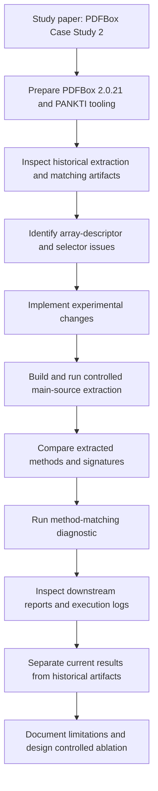

# PANKTI–PDFBox Reproduction

**Author:** Niloofar Asadi  
**Background:** Senior Software Engineer with 10+ years of software development experience  
**Research area:** Empirical software engineering, software testing, and AI-assisted software engineering  
**Subject system:** Apache PDFBox 2.0.21  
**Status:** Partial reproduction and diagnostic investigation

## About this project

I am a software engineer with more than ten years of experience, mainly working on software development, maintenance, debugging, and improving the quality of real-world applications. Through this work, I have become interested in understanding how software testing techniques can help developers find problems earlier and make software systems more reliable.

I started this project to study and reproduce part of the PDFBox case study from the paper *Production Monitoring to Improve Test Suites*. I wanted to go beyond reading the paper: I wanted to set up the experiment, inspect the tools and generated data, understand where the results came from, and investigate differences I found along the way.

This repository is my working record of that process. It includes the steps I took, the issues I investigated, the results I could verify, and the questions that still need further experiments. I have tried to keep the conclusions close to the evidence rather than present unfinished work as a complete reproduction.

## Study and target system

This work focuses on the PDFBox case study (Section IV.C and Table IV) in:

> Deepika Tiwari, Long Zhang, Martin Monperrus, and Benoit Baudry, *Production Monitoring to Improve Test Suites*.

Paper: https://arxiv.org/abs/2012.01198

The subject system is Apache PDFBox 2.0.21.

## Research focus

In this stage, I am investigating method extraction and method matching, especially multidimensional-array parameter descriptors and selector behavior.

My current research question is:

> To what extent does correcting multidimensional-array descriptors explain the unmatched methods in the PDFBox case study, when source scope and other selector behavior are held constant?

This is **not** a claim of complete end-to-end reproduction. The current work is a partial reproduction and diagnostic investigation.

## Workflow

The diagram below summarizes the process I followed and the evidence I collected.

A more detailed description of the steps is available in [docs/research-workflow.md](docs/research-workflow.md).

## Key findings so far

- The original signature logic I inspected represented an array parameter with one `[` regardless of dimensionality. My experimental implementation preserves array depth (for example, `float[][]` → `[[F`).
- The controlled extraction recorded the expected `[[F` descriptor for `PDAnnotationMarkup.setInkList(float[][])`.
- The combined experimental changes coincided with two additional matched methods: `PDAnnotationMarkup.setInkList` and `ByteTrie.addPath`.
- The historical matching diagnostic reported 2,204 matches out of 2,760 eligible Descartes methods (79.86%). The experimental diagnostic reported 2,206 matches and 554 unmatched methods (79.93%).
- My experimental run included both the array-signature correction and a null-declaring-type guard in `MockableSelector`. I have not yet isolated the contribution of each change.
- I treat existing downstream test reports as historical artifacts unless I can independently regenerate them in the current experiment.

I describe the evidence and limitations in [docs/experimental-findings.md](docs/experimental-findings.md), with additional detail in [REPORT.md](REPORT.md).

## Repository contents

- [REPORT.md](REPORT.md) — detailed reproduction and diagnostic report.
- [docs/research-workflow.md](docs/research-workflow.md) — the workflow I followed, with a process diagram.
- [docs/experimental-findings.md](docs/experimental-findings.md) — results, evidence, and limitations.

## How I approach reproducibility

For each new experiment, I aim to record the exact source revision, source scope, command, configuration, output artifacts, and SHA-256 hashes. I keep baseline and candidate outputs separate. I also avoid attributing an observed change to one code modification unless a controlled comparison isolates that modification.

## Next step

My next step is to run a four-way ablation with identical PDFBox source scope and inputs:

| Configuration | Array-signature fix | Null guard |
|---|---:|---:|
| A — baseline | No | No |
| B — signature only | Yes | No |
| C — guard only | No | Yes |
| D — combined | Yes | Yes |

This should help me understand which change explains the two additional matches and investigate the methods that are still unmatched.
