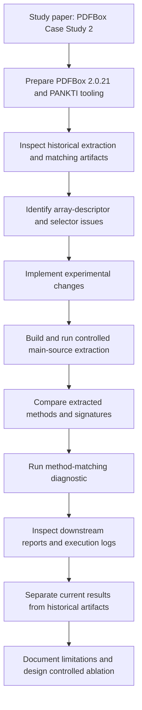

# PANKTI–PDFBox Reproduction

**Author:** Niloofar Asadi  
**Research area:** Empirical software engineering, software testing, and AI-assisted software engineering  
**Subject system:** Apache PDFBox 2.0.21  
**Status:** Partial reproduction and diagnostic investigation

This repository documents a targeted reproduction of the PDFBox case study (Section IV.C and Table IV) in:

> Deepika Tiwari, Long Zhang, Martin Monperrus, and Benoit Baudry, *Production Monitoring to Improve Test Suites*.

Paper: https://arxiv.org/abs/2012.01198

## Research focus

The investigation examines method extraction and method matching, with particular attention to multidimensional-array parameter descriptors and selector behavior.

Research question:

> To what extent does correcting multidimensional-array descriptors explain the unmatched methods in the PDFBox case study, when source scope and other selector behavior are held constant?

This is **not** a claim of complete end-to-end reproduction. The current work is a partial reproduction and diagnostic investigation.

## Workflow

The diagram below summarizes the research process and evidence flow.

A detailed stage-by-stage description is available in [docs/research-workflow.md](docs/research-workflow.md).

## Key findings so far

- The original signature logic inspected represented an array parameter with one `[` regardless of dimensionality. The experimental implementation preserves array depth (for example, `float[][]` → `[[F`).
- The controlled extraction recorded the expected `[[F` descriptor for `PDAnnotationMarkup.setInkList(float[][])`.
- The combined experimental changes coincided with two additional matched methods: `PDAnnotationMarkup.setInkList` and `ByteTrie.addPath`.
- The historical matching diagnostic reported 2,204 matches out of 2,760 eligible Descartes methods (79.86%). The experimental diagnostic reported 2,206 matches and 554 unmatched methods (79.93%).
- The experimental run included both the array-signature correction and a null-declaring-type guard in `MockableSelector`; therefore, the contribution of each change has not yet been isolated.
- Existing downstream test reports are treated as historical artifacts unless independently regenerated in the current experiment.

See [docs/experimental-findings.md](docs/experimental-findings.md) and the detailed [REPORT.md](REPORT.md).

## Repository contents

- [REPORT.md](REPORT.md) — detailed reproduction and diagnostic report.
- [docs/research-workflow.md](docs/research-workflow.md) — end-to-end workflow and process diagram.
- [docs/experimental-findings.md](docs/experimental-findings.md) — results, evidence, and limitations.

## Reproducibility principles

For every new experiment, record the exact source revision, source scope, command, configuration, output artifacts, and SHA-256 hashes. Keep baseline and candidate outputs separate. Do not attribute an observed change to one code modification unless a controlled comparison isolates that modification.

## Next planned step

Run a four-way ablation with identical PDFBox source scope and inputs:

| Configuration | Array-signature fix | Null guard |
|---|---:|---:|
| A — baseline | No | No |
| B — signature only | Yes | No |
| C — guard only | No | Yes |
| D — combined | Yes | Yes |

This will help attribute the two additional matches and investigate the remaining unmatched methods.
