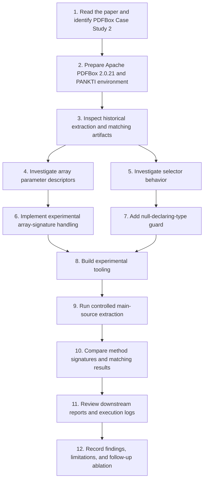

# Research workflow

This document describes the steps I have taken so far for the partial reproduction of the PDFBox case study in *Production Monitoring to Improve Test Suites*.

I come to this work from an industry software engineering background, with more than ten years of experience in software development and maintenance. I wanted to understand the research process in practice: preparing the environment, tracing how the tools produce their results, checking unexpected differences, and being careful about what the available evidence can actually support.

The workflow below is a record of the investigation so far, not a claim that every stage of the original study has been reproduced.

## End-to-end process

## 1. Paper and target system

- Target paper: *Production Monitoring to Improve Test Suites*.
- Target case study: PDFBox, Section IV.C and Table IV.
- Subject system: Apache PDFBox 2.0.21.

## 2. Historical artifacts and scope

I first inspected the historical extraction and matching artifacts available in the project. I then ran a controlled extraction targeting PDFBox main source code under `pdfbox/src/main/java`.

The historical and controlled extraction runs do not have a confirmed identical source scope. For that reason, I do not treat differences in row counts as an effect of the signature correction alone.

## 3. Code changes I investigated

### Array parameter descriptors

While checking method signatures, I found that the original logic represented any array parameter with a single `[`, even when the parameter had more than one dimension. I changed the experimental implementation to preserve the number of dimensions.

Examples:
- `float[]` → `[F`
- `float[][]` → `[[F`
- `String[][]` → `[[Ljava/lang/String;`

### Selector null guard

I also investigated a separate issue in `MockableSelector`. The experimental version handles a missing declaring-type reference by returning `false` instead of dereferencing null. I keep this change separate in my analysis because it may affect mockability classification independently of method signatures.

## 4. Controlled extraction

The controlled main-source extraction reported:
- Methods processed: **5,801**
- Methods extracted: **4,204**
- Nested invocations on fields or parameters: **2,677**

The resulting CSV is identified in the research report as `controlled-main-only/extracted-methods-pdfbox-main-only-void.csv`.

## 5. Matching diagnostic

The historical diagnostic reported 2,204 matches among 2,760 eligible Descartes methods (79.86%). The experimental diagnostic reported 2,206 matches (79.93%), with 554 unmatched methods.

The two additional matched methods were:
- `PDAnnotationMarkup.setInkList`
- `ByteTrie.addPath`

Both experimental code changes were present in that run. I therefore cannot yet say how much each change contributed to the result.

## 6. Downstream artifacts

I also reviewed the existing PDFBox README figures and `execution/system-test-report.csv`. They contain different summaries. The CSV totals align with the paper's system-test results, but I have not independently regenerated those results as part of this investigation. I therefore refer to them as historical artifacts.

## 7. How I report the evidence

I try to distinguish three types of statements in my notes:
- **Observed:** directly supported by a measured result or inspected artifact.
- **Interpretation:** a possible explanation of an observation.
- **Unresolved:** a question that still needs a controlled experiment.

This distinction is important to me because I want the report to show not only what appears to work, but also what I have not established yet.

## 8. Next experiment

My next step is a four-way ablation under identical source scope and inputs:
1. baseline (no array fix, no guard);
2. array-signature fix only;
3. null guard only;
4. both changes.

For every configuration, I plan to record the source revision, command, source scope, extracted methods, eligible methods, matched and unmatched methods, duplicate matches, and match rate.
