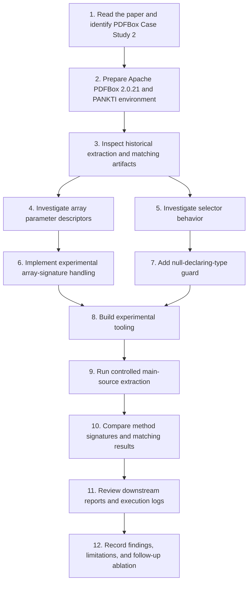

# Research workflow

This document summarizes the work performed for the partial reproduction of the PDFBox case study in *Production Monitoring to Improve Test Suites*.

## End-to-end process

## 1. Paper and target system

- Target paper: *Production Monitoring to Improve Test Suites*.
- Target case study: PDFBox, Section IV.C and Table IV.
- Subject system: Apache PDFBox 2.0.21.

## 2. Historical artifacts and scope

Historical extraction and matching artifacts were inspected as references. The controlled extraction targeted PDFBox main source code under `pdfbox/src/main/java`.

The historical and controlled extraction runs do not have a confirmed identical source scope. Consequently, differences in row counts must not be attributed to the signature correction alone.

## 3. Code changes examined

### Array parameter descriptors

The original logic represented any array parameter with a single `[`. The experimental implementation counts array dimensions and emits the corresponding number of brackets.

Examples:
- `float[]` → `[F`
- `float[][]` → `[[F`
- `String[][]` → `[[Ljava/lang/String;`

### Selector null guard

The experimental `MockableSelector` handles a missing declaring-type reference by returning `false` rather than dereferencing null. This is a separate behavioral change and may affect mockability classification.

## 4. Controlled extraction

The controlled main-source extraction reported:
- Methods processed: **5,801**
- Methods extracted: **4,204**
- Nested invocations on fields or parameters: **2,677**

The resulting CSV is identified in the research report as `controlled-main-only/extracted-methods-pdfbox-main-only-void.csv`.

## 5. Matching diagnostic

The historical diagnostic reported 2,204 matches among 2,760 eligible Descartes methods (79.86%). The experimental diagnostic reported 2,206 matches (79.93%), with 554 unmatched methods.

The two additional matched methods were:
- `PDAnnotationMarkup.setInkList`
- `ByteTrie.addPath`

Because the experimental run included both code changes, the current evidence does not isolate the contribution of each change.

## 6. Downstream artifacts

Existing PDFBox README figures and `execution/system-test-report.csv` contain different summaries. The CSV totals align with the paper's system-test results, but this does not prove that the current investigation regenerated those results. They are therefore treated as historical artifacts.

## 7. Reporting discipline

Each claim should be classified as:
- **Observed:** directly supported by a measured result or inspected artifact.
- **Interpretation:** a reasonable explanation of observations.
- **Unresolved:** a hypothesis that needs a controlled experiment.

## 8. Next experiment

Run a four-way ablation under identical source scope and inputs:
1. baseline (no array fix, no guard);
2. array-signature fix only;
3. null guard only;
4. both changes.

Record source revision, command, source scope, extracted methods, eligible methods, matched and unmatched methods, duplicate matches, and match rate for every configuration.
